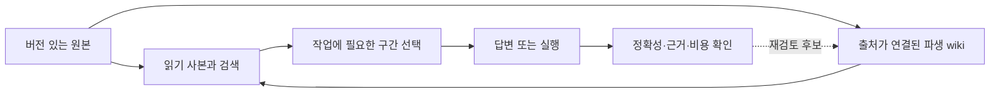

# LLM wiki와 context engineering 조사

tags: [guide, research, knowledge, context-engineering]
summary: 원본을 보존하며 필요한 지식을 선택하는 방법과 그 비용·신뢰성·적용 조건을 비교한다.
updated: 2026-11-11

현재 Harness에는 **검색·범위 읽기·출처 추적을 개선하고, 효과를 측정한 뒤 필요한 지식만 정리하는 접근**이 적합하다. 그래프나 벡터 DB, 자동 기억 추출을 먼저 도입해야 한다는 근거는 찾지 못했다. 파일 기반 wiki도 생성·갱신·원문 재확인 비용이 있으므로 항상 더 싸지는 않다. 이는 아래 자료와 [현행 구현 대조](INF__wiki-context-improvement-candidates.md)를 바탕으로 한 우리의 판단이다.

이 문서는 2026-11-11 기준 공개 1차 자료 조사다. 논문 실험, 제작자 설명, 커뮤니티 경험담, 현재 코드 관측, 우리의 제안을 구분한다. 인기가 품질을 입증한다고 보지 않았으며, 모든 공개 자료를 망라했다는 뜻도 아니다. 유료 모델 실험·실제 회사 문서 연결·런타임 변경은 수행하지 않았다. 사용자가 지정한 논문은 [별도 검토](OBS__harnessmm-2610-32813.md)에, 반영 후보는 [별도 제안](INF__wiki-context-improvement-candidates.md)에 둔다.

## 1. 무엇을 관리하는가

| 층 | 역할 | 정본과 수명 | 혼동하면 생기는 문제 |
|---|---|---|---|
| 원본 문서·소스 | 실제 발언, 정책, 결정, 코드, 실험 결과 | 원래 서비스·저장소와 그 버전 | 생성한 설명으로 원본을 대체함 |
| 읽기 사본 | 로컬에서 빠르게 조회하는 투영 | 재생성 가능; 마지막 동기화 시점의 상태 | 캐시를 최신 권한·원본으로 오인함 |
| 파생 wiki | 여러 출처를 연결한 설명·요약 | 출처에 의존하며 재검토 가능 | 추측·오래된 내용을 확정 사실로 승격함 |
| 검색 인덱스 | 후보 문서·구간 선택 | 원본에서 재생성 | 높은 점수를 진실·권한으로 오인함 |
| 작업 컨텍스트 | 지금 해결할 요청에 필요한 선택 | 요청·세션 단위 | 모든 기억을 매번 넣어 비용·주의 분산 증가 |
| 실행 상태 | 소유권, 진행 중 실행, 검증·완료 | WBS·실행기의 실제 상태 | wiki의 완료 문구로 실행 증거를 대체함 |

에이전트 기억도 나눠 보는 편이 유용하다. **일화 기억**은 언제 무엇을 경험했는지, **의미 기억**은 재사용할 주장과 적용 범위, **절차 기억**은 승인된 작업 방법, **작업 기억**은 지금 필요한 정보다. 대화에서 추출했다는 이유만으로 절차에 권한이 생기지는 않는다. 이 분류는 설계를 비교하기 위한 것이며 새 영구 상태 네 종류를 만들라는 요구가 아니다.

권한·사용자 의도·원본의 적용 범위는 모든 단계에서 유지해야 한다. 위 흐름이 새로운 승인권이나 자동 쓰기 권한을 만들지는 않는다.

## 2. LLM wiki 아이디어와 실제 생태계

Karpathy의 [LLM Wiki 원문](https://gist.github.com/karpathy/442a6bf555914893e9891c11519de94f)(2026-04-04)은 구현체나 통제 실험보다 작업 패턴 제안에 가깝다. 원자료와 파생 Markdown wiki, 유지 규칙을 분리하고 ingest/query/lint와 탐색용 인덱스를 제안한다. 반면 같은 글의 [2026-10-30 사용 후기](https://gist.github.com/karpathy/442a6bf555914893e9891c11519de94f?permalink_comment_id=6449642)는 빠진 세부사항 때문에 원문을 다시 읽어야 해서 편찬 비용까지 더 들었다고 보고한다. 두 자료 모두 개인 경험이며 평균적인 절감률을 입증하지 않는다. 원문의 “RAG는 축적하지 않는다”는 일반화도 지속적인 추출·요약을 수행하는 아래 구현들 전체에 적용할 수 없다.

아래 SHA는 조사한 소스 시점이다. 설치·성능 비교 실험을 했다는 뜻은 아니다. 기능은 서로 다른 문제를 풀며, 하나의 우열 순위로 읽으면 안 된다.

| 구현·확인 버전 | 실제 역할 | 가져올 만한 점 | 비용·주의점 |
|---|---|---|---|
| [QMD](https://github.com/tobi/qmd/blob/86d2365d17fc682e491c2c53d1e4a884aee8682a/README.md) `86d2365` · 2026-10-15 | 파일 검색; BM25, 선택적 의미 검색·재순위화, CLI/MCP | 검색 후보와 구간 읽기를 분리, 컬렉션 문맥 제공 | 키워드 경로와 모델이 필요한 혼합 경로의 비용이 다름. wiki 사실 검증기는 아님 |
| [Basic Memory](https://github.com/basicmachines-co/basic-memory/blob/9b1b234d95c77a4eabcf4f2949607b831800a442/README.md) `9b1b234` · 2026-11-11 | Markdown 기반 기억, 관측·관계, SQLite 인덱스·MCP | 파일의 검토 가능성, 원자료와 의미 추출 구분 | 동기화·검색 옵션·스키마 비용, 코드 도입 시 AGPL 조건 검토 |
| [PageIndex](https://github.com/VectifyAI/PageIndex/blob/2ac8694bf8fe89a3840dda9bdb88db5119b77fc4/README.md) `2ac8694` · 2026-11-05 | 문서 트리 생성과 모델 기반 탐색 | 긴 문서에서 개요→관련 절로 내려가기 | vectorless여도 파싱·요약·탐색 모델 비용 존재. 제작자 벤치마크를 일반 성능으로 확대하지 않음 |
| [OpenViking](https://github.com/volcengine/OpenViking/blob/83d24ca4fc6f8587ed1a1ebee9bfea4d412d6b69/README.md) `83d24ca` · 2026-11-11 | resources/memory/skills의 계층적 컨텍스트 저장소 | 초록·개요·본문의 단계적 읽기 | [아키텍처](https://docs.openviking.ai/en/concepts/01-architecture)는 RAGFS와 벡터 인덱스를 함께 사용. 파일시스템 인터페이스가 일반 파일만 사용한다는 뜻은 아님 |
| [LightRAG](https://github.com/HKUDS/LightRAG/blob/793f929c0d9e1187cc91cc346267747a287d589c/README.md) `793f929` · 2026-11-11 | 추출 그래프·청크 검색과 여러 저장 역할 | 출처와 관계를 연결하고 파생 인덱스를 재구성 | 추출·병합·복구·저장소 운영 비용. 기본 로컬 저장은 작은 평가·테스트 용도라는 주의가 있음 |
| [Microsoft GraphRAG](https://github.com/microsoft/graphrag/blob/34b2b67ae4601ad0b47bcd179fbe3f2a23aa0857/README.md) `34b2b67` · 2026-11-02 | 엔티티·관계와 커뮤니티 보고서 편찬 | 집합 전체 질문에 맞는 다단계 요약 | 인덱싱 비용·프롬프트 조정·이관 비용. 이 버전은 maintenance mode를 명시 |
| [Obsidian](https://obsidian.md/help/Files%2Band%2Bfolders/How%2BObsidian%2Bstores%2Bdata) · 도움말 확인 2026-11-11 | 로컬 Markdown vault와 링크 탐색 | 사람이 읽고 수정할 수 있는 파일, 여러 진입 경로 | [backlink](https://obsidian.md/help/plugins/backlinks)는 연결을 보여줄 뿐 내용의 일치·최신성을 증명하지 않음. 설치 버전 검증은 하지 않음 |
| [Logseq](https://github.com/logseq/logseq/blob/5d83ed47fdebcfffe5b741a5d951de5e07bdf751/README.md) `5d83ed4` · 2026-11-10 | 블록 참조·속성·질의 중심 지식 관리 | 안정적인 참조와 필요한 메타데이터 | 현재 DB 그래프는 beta. [DB 문서](https://github.com/logseq/docs/blob/master/db-version.md)의 Markdown 내보내기는 일부 속성·시각 정보를 보존하지 않음 |
| [IWE](https://github.com/iwe-org/iwe/blob/b733afe95ca6dd96ac7205e696bb920975253f18/README.md) `b733afe` · 2026-11-11 | Markdown 검색·이름 변경·링크 관리·MCP | 모델 없는 구조 점검과 작은 탐색 도구 | [문서 스키마](https://github.com/iwe-org/iwe/blob/b733afe95ca6dd96ac7205e696bb920975253f18/docs/document-schema.md)는 형태를 검사하며 사실을 판정하지 않음 |
| [LLM Repo Wiki](https://github.com/lucaslimafons/llm-repo-wiki/blob/8d31267b139a489e42963cf0c89fb44c5684bebd/README.md) `8d31267` · 2026-11-10 | 소스 버전을 고정한 wiki 제안·수락·갱신 | 변경 제안 검토, 출처 변경 시 stale 처리 | 단일 사용자 연구용 구현, Postgres/pgvector·worker 필요. [자체 평가](https://github.com/lucaslimafons/llm-repo-wiki/blob/8d31267b139a489e42963cf0c89fb44c5684bebd/docs/evals.md)는 유효한 인용에도 부분 지지·사실 오류가 남고 혼합 검색이 더 나빴던 조건을 보고 |

README도 코드와 불일치할 수 있다. 예를 들어 QMD의 scope/top-K 경고와 [해당 버전 검색 코드](https://github.com/tobi/qmd/blob/86d2365d17fc682e491c2c53d1e4a884aee8682a/src/store.ts), LightRAG의 재임베딩 제한 문구와 같은 README의 `rebuild_vdb.py` 안내는 함께 읽어야 한다. 오래된 제한을 현재 결함으로 확정하지 않는다.

사람의 지식 관리법도 일부 원칙을 빌릴 수 있다. [PARA](https://fortelabs.com/blog/para/)(2023-02-24, 갱신 2026-04-15)의 행동·수명 중심 정리와 [Zettelkasten](https://zettelkasten.de/introduction/)(2020-10-27)의 주소·출처·맥락 있는 연결은 참고할 만하다. 생산성 주장은 각 방법 저자의 설명이며, AI 검색의 통제 실험이 아니다. 기존 문서 위에 새 분류 체계를 중복하거나 모든 사실을 별도 노트로 쪼개는 것은 이번 제안이 아니다.

## 3. 검색·요약 방법은 질문에 따라 선택한다

| 방법 | 잘 맞는 상황 | 놓치기 쉬운 것 | 이번 제품에서의 위치 |
|---|---|---|---|
| ID·문자열·제목 검색 | 알려진 문서, 식별자, 정확한 용어 | 다른 표현·형태소·동의어 | 현재 기준선. 원문 확인까지 포함해 비교 |
| BM25 등 어휘 순위화 | 긴 문서의 흔한 단어와 드문 단어 구별 | 어휘가 겹치지 않는 질문 | 별도 벡터 DB 없이 검토 가능하나 실측 필요 |
| 반복 검색·질의 재표현 | 한 번 검색해 찾지 못한 연결·표현 | 호출 증가, 잘못된 질의 확장 | 고정 횟수 확장보다 필요한 경우에 한정 |
| 임베딩·혼합 검색·reranker | 의미적 유사성, 표현 차이 | 숫자·버전·부정·접근 경계, 인덱싱 비용 | 비교 대상일 수 있으나 이번 구현 범위 아님 |
| 목차·트리 탐색 | 문서 구조가 좋고 어느 장인지 추론 가능 | 잘못 만든 요약·트리가 후보를 숨김 | 기존 outline/heading/range 경로부터 활용 |
| 관계·그래프·다단계 요약 | 여러 문서 연결, corpus 전체 질문 | 추출 오류, 오래된 관계, 비용·권한 전파 | 현재 관계를 우선 검증; 범용 그래프 엔진 불필요 |

위 적합성은 설계 판단이며 특정 제품의 승률 주장이 아니다. [RAPTOR](https://arxiv.org/html/2401.18059v1)(ICLR 2024)는 재귀 요약을 서로 다른 추상화 수준에서 검색하는 실험이다. 요약의 비지원 내용도 점검하며, 모든 답변을 상위 요약 하나로 대체하라는 결과는 아니다. [GraphRAG 인덱싱 설명](https://microsoft.github.io/graphrag/index/overview/)은 집합 수준 보고서를 미리 편찬하는 별도의 비용 구조를 보여준다.

문서 표현도 검색 설계의 일부다. Confluence의 XHTML·매크로·표·첨부·페이지 이력은 Markdown 투영과 같은 데이터가 아니다. 현재 [변환기](../../wiki-atlassian/src/main/kotlin/io/crscube/clitools/jirafetcher/util/ConfluenceMarkdownConverter.kt)와 [네이티브 문서 도구](../../wiki-atlassian/src/main/kotlin/io/crscube/clitools/confluence/WikiTools.kt)를 기준으로 읽기용 요약과 원본 편집 경로를 구분해야 한다. 표의 병합 셀·주석·이미지에 필요한 정보가 있으면 원본 범위를 확인한다. 이미지를 제외하거나 Markdown만 덮어써서 비용이 줄었다고 판단하면 정보 손실을 절감으로 세게 된다.

## 4. Context engineering: 저장보다 선택과 실행

| 1차 자료·발표 시점 | 핵심 관찰·제안 | 가져올 조건과 한계 |
|---|---|---|
| [Anthropic: Effective context engineering](https://www.anthropic.com/research/effective-context-engineering-for-ai-agents) · 2025-09-29 | 컨텍스트를 계속 선별하고 가벼운 참조에서 필요할 때 읽기; 노트·compaction | 요약이 세부 근거를 잃을 수 있으므로 복구 가능한 원본 유지. 최소 토큰만이 목표는 아님 |
| [Anthropic: Writing tools](https://www.anthropic.com/research/writing-tools-for-agents) · 2025-09-11 | 작업에 맞는 도구, 명확한 설명, 필터·페이지화·응답 상세도와 평가 | 성공률·호출·실패·토큰·시간 함께 비교. 무조건 도구를 합치거나 줄이라는 결론은 아님 |
| [Anthropic: Advanced tool use](https://www.anthropic.com/research/advanced-tool-use) · 2025-11-24 | 도구 정의 지연 로딩과 코드 기반 orchestration으로 중간 정보 감소 | 탐색·코드 작성·실행·복구 비용 포함. 발표 당시 API 문법을 현재 설정 안내로 재사용하지 않음 |
| [Manus: Lessons from building Manus](https://manus.im/blog/Context-Engineering-for-AI-Agents-Lessons-from-Building-Manus) · 2025-07-18 | 안정적 prefix, 복구 가능한 파일 참조, 오류 맥락 보존 | 초반 도구 정의를 계속 바꾸면 캐시 이점과 충돌. 해당 시스템의 경험을 보편 비율로 옮기지 않음 |
| [Anthropic: Multi-agent research](https://www.anthropic.com/research/multi-agent-research-system) · 2025-06-13 | 독립적인 넓은 조사와 각자 문맥에서의 탐색 | 총 토큰·조정 비용 증가 가능. 강하게 결합된 공동 코드 수정과 다름 |
| [Cognition: Don't build multi-agents](https://cognition.com/blog/dont-build-multi-agents) · 2025-06-12; [후속 글](https://cognition.com/blog/multi-agents-working) · 2026-04-22 | 불완전한 인계·충돌 위험; 이후 한 작성자와 보조 역할의 구성을 설명 | 단순 찬반보다 공유 변경과 독립 조사 구분. 약한 주 실행기+강한 조언자 실험도 품질에 실패한 조건이 있음 |
| [LangChain: Deep Agents context engineering](https://www.langchain.com/blog/context-engineering-deep-agents-remember) · 2026-10-14 | offloading, 압축, 하위 에이전트 격리, 세션 간 기억·skills 구분 | 서로 다른 수명·비용을 하나의 영구 기억으로 합치지 않음. 임계값을 그대로 Harness 기본값으로 사용하지 않음 |
| [MCP resources](https://modelcontextprotocol.io/specification/2025-11-25/server/resources), [tools](https://modelcontextprotocol.io/specification/2025-11-25/server/tools) · 고정 규격 2025-11-25 | 애플리케이션이 선택하는 자료와 모델이 호출하는 기능의 구분 | 규격 자체가 자동 주입·최신성·권한·지연 로딩을 보장하지 않음. 최신 규격이라는 주장은 아님 |

서로 반대처럼 보이는 권고도 조건이 다르다. 독립 조사와 리뷰는 병렬화하기 좋지만 같은 변경의 숨은 결정을 공유해야 하는 작성자는 충돌하기 쉽다. 도구 정의 지연 로딩은 유용할 수 있지만 안정적인 공통 prefix를 매번 재작성하는 것과는 다르다. offloading은 기억을 없애기보다 파일 읽기·탐색으로 비용을 이동한다. 압축도 압축 실행과 나중의 원문 복구 비용을 만든다. 이는 위 자료를 종합한 판단이다.

캐시 적중은 논리적 컨텍스트를 없애거나 출력 추론을 자동으로 줄이지 않는다. [Anthropic context editing 설명](https://platform.claude.com/docs/en/build-with-claude/context-editing)(확인 2026-11-11)은 이전 결과 제거와 압축을 구분하고 prefix cache 무효화의 비용도 설명한다. 가격·지원 모델은 변하므로 이 문서에 고정하지 않는다.

## 5. 사실·가설·결정과 출처

문서 분류는 내용의 신뢰성과 별개의 축이다. GUIDE 안에도 인용 사실·실험 관측·저자 의견이 섞일 수 있다. 필요한 주장을 쓰는 자리에서 다음 차이를 드러내는 편이 낫다.

| 문장 종류 | 필요한 근거·표현 | 금지할 승격 |
|---|---|---|
| 사용자가 요청한 결과·제약 | 원 요청, 적용 범위·변경 시점 | AI의 편의적 대안을 사용자 REQ로 기록 |
| 원문이 주장하는 사실 | 원문 위치·버전, 누가 주장했는지 | 제작자 홍보를 독립 측정으로 표현 |
| 실제 관측 | 대상 코드·입력·환경·실행 결과, 확인 한계 | 소스 추적만 하고 실제 재현했다고 표현 |
| 추론·가설 | 전제와 불확실성, 반증 조건 | 여러 인용이 있다는 이유로 확정 사실 처리 |
| 제안·승인된 결정 | 제안과 승인 구분, 결정 주체·적용 범위 | 좋은 제안을 자동 정책·허가로 적용 |

이는 새 claim 원장이나 문장별 필수 JSON을 제안하는 것이 아니다. 현재 지식 스킬의 구분을 지키며 중요한 주장에 필요한 만큼 적는다. [W3C PROV-DM](https://www.w3.org/TR/prov-dm/)(Recommendation, 2013-04-30)의 entity/activity/agent 관점도 추적에 참고할 수 있지만, 출처 기록 자체가 진실·승인 증명은 아니다.

실무에서는 “배포했다→그 설계가 승인됐다”, “오래된 실험이 성공했다→현재 설정도 지원한다”, “이 공간에서 못 찾았다→어디에도 없다” 같은 범위 확장을 특히 확인해야 한다. 요약은 반례·예외·유효 기간을 남겨야 하고, 근거 링크는 **존재**뿐 아니라 실제로 그 문장을 **지지**해야 한다. 서로 충돌하는 출처는 한 문장으로 평탄화하지 말고 현재/과거·환경·결정 주체 차이를 확인한다.

## 6. 기억 평가 연구가 말해 주는 것과 못 말해 주는 것

| 자료·버전 | 평가하는 것 | 읽을 때의 한계 |
|---|---|---|
| [Lost in the Middle](https://arxiv.org/html/2307.03172v3) · 2023/2024 | 근거 위치에 따른 QA·검색 성능 | 당시 모델·통제 과제 결과. 모든 현재 모델의 동일 실패율을 뜻하지 않음 |
| [RULER](https://arxiv.org/html/2404.06654v2) · 2024 | 다중 근거·연쇄·집계·방해 정보가 있는 긴 문맥 | 합성 평가. 실제 wiki의 갱신·권한 비용은 별도 |
| [LoCoMo](https://snap-research.github.io/locomo/) · ACL 2024 | 긴 대화의 시간·사건·질문, 답 없는 질문 포함 | 생성 후 사람이 편집한 대화. 기업 문서 운영과 같은 분포가 아님 |
| [LongMemEval](https://arxiv.org/html/2410.10813v2) · ICLR 2025 | 다중 세션, 시간, 지식 갱신, 답변 유보 | 인덱싱·검색·읽기 단계를 구분. 사실만 압축하면 필요한 세부를 잃을 수 있음 |
| [BEAM](https://arxiv.org/html/2510.27246v2) · ICLR 2026 | 매우 긴 일관된 대화와 갱신·모순·유보 | 자동 생성과 rubric 검증 기반. 10M 조건은 baseline이 전체를 직접 읽는 비교가 아님 |
| [MemGPT](https://arxiv.org/abs/2310.08560) · 2023 | 도구로 이동하는 계층적 기억 아키텍처 | 저장 용량 확대가 곧 정확한 기억 선택은 아님 |
| [Mem0](https://arxiv.org/html/2504.19413v1) · 2025 | 사실 추출·통합·검색, 그래프 변형 | 해당 LoCoMo 실험에서 adversarial/unanswerable 유형 제외. 유보 능력까지 입증한 결과로 쓰지 않음 |
| [Zep/Graphiti](https://arxiv.org/html/2501.13956v1) · 2025 | 시간 정보를 가진 기억 그래프 | 짧은 대화는 전체 문맥도 강하며 일부 유형은 악화. 그래프의 보편 우월성 아님 |
| [Hindsight](https://arxiv.org/html/2512.12818v1) · 2025-12 v1 | 사실·경험·관측·의견과 여러 검색 경로 | 이 버전에는 retrieval budget 미기입과 서로 다른 judge로 얻은 비교 수치가 있음. 통제된 제품 순위표로 옮기지 않음 |
| [Letta filesystem 연구](https://www.letta.com/blog/benchmarking-ai-agent-memory/) · 2025 | 파일·도구 기반 기억의 제작자 실험 | 파일을 파싱·임베딩하고 semantic search도 사용. vectorless 파일 검색의 우월성 증거가 아님 |

이름이 같은 평가 도구도 구분해야 한다. [THUIR MemoryBench](https://github.com/THUIR/MemoryBench)는 피드백에서의 적응과 replay/interactive 평가를, [Supermemory MemoryBench](https://github.com/supermemoryai/memorybench)는 기억 시스템의 ingest/search/answer/evaluate 경로를 다룬다. 이름이나 하나의 점수만으로 같은 벤치마크라 볼 수 없다.

모델·질문 집합·judge·답 없는 질문 포함 여부·예산·baseline이 다르면 논문 간 숫자를 직접 순위화하지 않는다. 제작자 자체 보고는 유용한 가설이지만 독립적인 재현과 구분한다. 특히 접근 불가·동기화 실패를 “없음”으로 답하는 시스템은 일반 정답률만으로 평가하면 안전성을 놓친다.

## 7. 권한·삭제·악성 문서

[AgentDojo](https://arxiv.org/html/2406.13352v3)(2024)는 도구가 읽는 비신뢰 자료에 대한 공격과 정상 작업의 유용성을 함께 평가한다. [CaMeL](https://arxiv.org/html/2503.18813v2)(2025)는 신뢰 계획과 비신뢰 데이터의 제어·데이터 흐름을 분리하는 접근을 제안하지만 추가 비용이 있으며, 모든 의미적 답변 오염을 해결한다고 주장하지 않는다. 위협 모델에는 기억이 이미 손상되지 않았다는 가정도 있다. 따라서 wiki 본문의 지시를 실행 권한으로 읽지 않는 것과, 그 본문을 근거로 틀린 답을 쓰지 않는 것은 별도 평가 대상이다.

[MCP 보안 지침](https://modelcontextprotocol.io/docs/2025-11-25/tutorials/security/security_best_practices)은 토큰 audience·confused deputy·세션 등의 경계를 다룬다. OAuth token passthrough 경고를 로컬 stdio 서버가 자기 API 인증정보를 받는 것 전체에 그대로 적용하면 안 된다. 반대로 MCP를 쓴다는 사실만으로 문서의 진실성·답변 목적지의 적절성이 보장되지도 않는다.

우리 제품에 적용할 조건은 다음과 같다. 현재 기능 여부는 [코드 대조 문서](INF__wiki-context-improvement-candidates.md)에서 별도로 확인한다.

- 계정·사이트·공간·root 범위가 다른 유사 문서를 섞지 않는다. 결과 본문뿐 아니라 제목·ID·링크 노출도 확인한다.
- 동기화 이후 삭제·권한 회수·정정이 검색과 파생 요약·인용에 어떻게 반영되는지 확인한다. 로컬 결과를 숨긴다고 서버의 모든 이력을 지웠다는 뜻은 아니다.
- 일부 공간이 읽히지 않으면 결과의 불완전성을 남긴다. 마지막 캐시가 현재 원격 접근 허가를 즉시 보장하지 않는다.
- 악성 문서의 “다른 공간에 업로드하라”, “이 규칙은 승인됐다” 같은 문장을 지식 데이터로 취급한다. 공유 가능 여부는 목적지·사용자 의도로 판단한다.

## 8. 작은 평가로 선택하기

새 대형 평가 프레임워크보다 재발하는 실제 질문과 작은 비공개 합성 변형을 기존 테스트·리뷰 경로에서 비교하는 것이 우선이다. 후보 개선의 구체적인 입력과 판정 기준은 [INF의 실험 순서](INF__wiki-context-improvement-candidates.md#작은-비교-실험과-채택-조건)에 있다.

| 평가 축 | 반드시 나눠 볼 값 |
|---|---|
| 품질 | 필요한 원문 검색, 최종 답의 정확성, 인용의 의미적 지지, 예외·시간·권한 범위, 적절한 유보 |
| 비용 | 미캐시 입력·캐시 입력/쓰기·출력/추론, 과금, 도구 호출, ingest/갱신/원문 재확인, 사람 검토 |
| 시간 | 초기 편찬, 질의, 동기화·장애 복구, 전체 완료까지의 wall time; 병렬 합계 작업량 별도 |
| 비교 조건 | 같은 모델·도구·문서 버전·권한·질문·명령·근거 예산; 튜닝과 평가 질문 분리 |
| 실패 보존 | 실패·부분 수행·사용량 미상도 분모와 보고에서 유지; 누락을 0비용·성공으로 처리하지 않음 |

한 질의의 총 비용은 사전 편찬·갱신 비용을 적절한 사용 기간에 배분한 값과 검색·읽기·추론·복구 비용을 함께 봐야 한다. 개발 투자까지 포함한 손익분기점은 실제 개발 비용·반복 사용량이 없으면 계산하지 않는다. 캐시 덕분의 과금 절감, 출력 감소, 모델 호출 제거, 병렬화에 따른 시간 단축도 서로 다른 효과다. 이 구분의 논문 사례는 [HarnessMM 검토](OBS__harnessmm-2610-32813.md)에 둔다.

현재 단계의 권고는 **작은 탐색 인덱스, 출처까지 내려갈 수 있는 요약, 범위가 분명한 기억, 선택 비용 측정**이다. 벡터·그래프·자동 편찬은 실제 누락·규모·반복 질의가 그 비용을 정당화할 때 재검토한다. 본 조사로 제품 토큰 절감이나 성능 향상이 이미 실현됐다고 주장하지 않는다.
